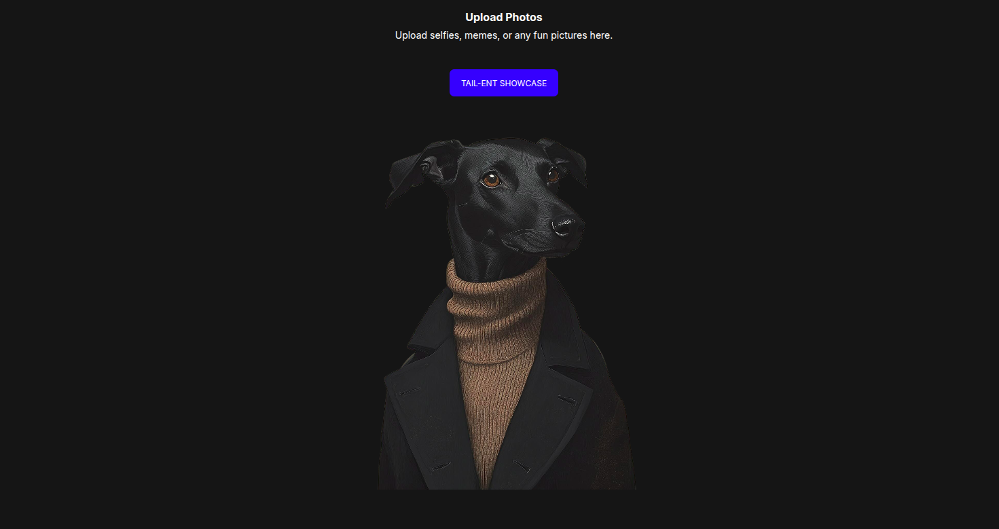
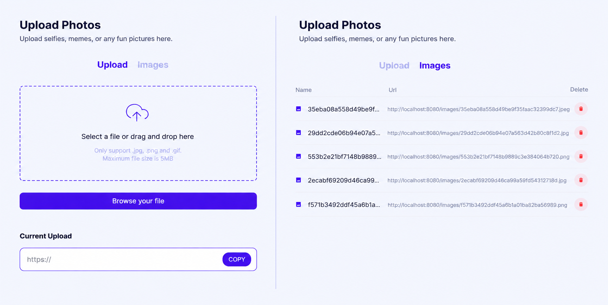

# Image Hosting Server

A simple Python-based HTTP server for uploading, storing and viewing images.


---

## Built With
* **Backend:** Pure Python
* **Web Server:** Nginx
* **Frontend:** HTML5, CSS3, JavaScript
* **Containerization:** Docker & Docker Compose
* **Database:** PostgreSQL 18

---

## Features
* Image upload (.jpg, .png, .gif, up to 5MB)
* File format and size validation
* Unique name and url generation for each image
* File serving through Nginx
* Image metadata stored in PostgreSQL
* Image list page with pagination
* Image deletion (database record and file on disk)
* Manual database backup and restore
* Logging of all actions to `logs/app.log`

---

## Project Structure
```
image-hosting-server/
├── assets/             # README image assets
├── backups/            # Database backups
├── images/             # Uploaded images
├── logs/
│   └── app.log         # Application logs
├── static/             # CSS, JS & image assets
├── templates/          # HTML
├── .dockerignore
├── .env.example        # Template for environment variables
├── .gitignore
├── app.py              # HTTP server
├── backup.sh           # Database backup script
├── docker-compose.yaml
├── Dockerfile
├── init.sql            # Creates the images table on first start
├── nginx.conf          # Nginx configuration
├── nginx.Dockerfile
└── requirements.txt    # Python dependencies
```



---

## Requirements
* Python 3.12+
* Docker & Docker Compose

---

## Launching
```
git clone git@github.com:Alice-vrb/image-hosting-server.git
cd image-hosting-server
cp .env.example .env
```

Fill in `.env` (see below), then start the project:

```
docker compose up --build
```

Open http://localhost:8080

---

### Configuration
| Variable | Description | Example |
| --- | --- | --- |
| `POSTGRES_USER` | Database user | `postgres` |
| `POSTGRES_PASSWORD` | Database password | choose your own |
| `POSTGRES_DB` | Database name | `images_db` |
| `DB_HOST` | Database host (service name in Docker Compose) | `db` |
| `DB_PORT` | Database port inside the Docker network | `5432` |

Notes:
* The `images` table is created from `init.sql` only on the first start, when the database volume is empty. To recreate the database from scratch, run `docker compose down -v`.
* If port `5432` is already in use on your machine, change the left number in the `db` service `ports` mapping (e.g. `"5433:5432"`). `DB_PORT` stays `5432`.

---

## Database
Image metadata is stored in the `images` table (see `init.sql`):

| Column | Type | Description |
| --- | --- | --- |
| `id` | SERIAL PRIMARY KEY | Unique image id |
| `filename` | TEXT | Generated unique file name |
| `original_name` | TEXT | File name provided by the user |
| `size` | INTEGER | File size in bytes |
| `upload_time` | TIMESTAMP | Upload date and time |
| `file_type` | TEXT | File format (jpg, png, gif) |

---

## Database Backup

Create a backup (saved to `backups/backup_YYYY-MM-DD_HHMMSS.sql`):
```
./backup.sh
```
The result is also written to `logs/app.log`.

Restore from a backup:
```
docker exec -i postgres_container sh -c 'psql -U "$POSTGRES_USER" -d "$POSTGRES_DB"' < backups/backup_<date_and_time>.sql
```

> Backups contain only database records (image metadata), not the image files in `images/`.

---

## Routes
| Method | Route | Description |
| --- | --- | --- |
| GET | `/` | Home page |
| GET | `/upload` | Image upload page |
| POST | `/upload` | Uploads one or more images (multipart form). Saves the file to `images/` and its metadata to the database. Returns JSON with the generated names and URLs, and per-file errors |
| GET | `/images-list` | Table of uploaded images, newest first, 10 per page. Use `?page=N` to switch pages (an invalid or out-of-range page falls back to the nearest valid one) |
| POST | `/delete/{id}` | Deletes the database record and the file on disk, then redirects (303) to `/images-list`. Returns 404 if the id does not exist and 400 if it is not a number |
| GET | `/images/{filename}` | The image file itself, served by Nginx |
| GET | `/static/...` | CSS, JS and image assets |



---

## Error handling
* If the database is unavailable or the metadata cannot be saved, the uploaded file is removed from disk and the error is logged.
* Invalid file extensions and files over 5MB are rejected with an error message for that file.

---

## Logging
All actions (uploads, deletions, backups) and errors are written to `logs/app.log` in the format `[YYYY-MM-DD HH:MM:SS] message`.

